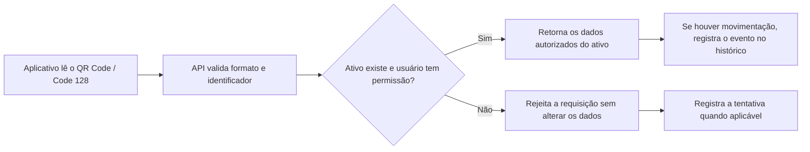

# 3.5 Ameaças e controles de segurança

**Projeto:** Sistema de Gestão de Laboratórios e Ativos — AtlasLab  
**Escopo:** PoC de leitura de QR Code/Code 128 e Realidade Aumentada (RA), aplicativo mobile, aplicação Web, API REST e banco de dados.

O projeto busca garantir que a consulta e a movimentação de ativos sejam confiáveis, com controle de acesso e histórico rastreável. A tabela abaixo relaciona ameaças específicas ao fluxo da PoC e aos requisitos de segurança definidos na Sprint 1.

## Ameaças e controles

| Componente | Ameaça / cenário | Consequência | Controle de segurança | Situação da implementação |
|---|---|---|---|---|
| Leitor de QR Code/Code 128 e consulta na API | Um marcador é adulterado, trocado ou contém um identificador inexistente ou pertencente a outro ativo. | A aplicação pode exibir informações do patrimônio errado ou associar uma movimentação ao equipamento incorreto. | A API deve validar o formato do identificador, localizar o ativo no banco e verificar se ele pode ser consultado. O aplicativo não deve confiar em dados descritivos embutidos no código; deve usar o identificador para consultar o registro central. Códigos inválidos ou sem correspondência devem ser rejeitados. | **Planejado — validar por teste** (RF05, RF06; PoC B05 e integração B09). |
| Campos enviados à API | Um usuário envia dados malformados, campos fora do limite, identificadores alterados ou conteúdo destinado a manipular uma consulta ao banco. | Erros de processamento, consulta indevida ou corrupção dos dados do ativo. | Validar os campos no servidor (tipo, formato, tamanho e obrigatoriedade), aceitar apenas valores esperados e usar consultas SQL parametrizadas. Requisições inválidas devem ser rejeitadas sem alterar o banco nem expor detalhes internos. | **Planejado — validar por teste** (API REST e banco no escopo do MVP). |
| Login e endpoints administrativos | Um usuário comum ou técnico tenta chamar diretamente um endpoint reservado a um perfil de maior privilégio. | Consulta, cadastro, alteração ou exclusão de dados sem autorização. | Autenticar o usuário e verificar sua função no servidor em toda operação protegida, não apenas ocultar botões na interface. Aplicar o menor privilégio e negar operações não autorizadas, registrando a tentativa quando pertinente. | **Planejado — validar por teste** (RS01, RF01–RF04, CA05 e backlog B07). |
| Movimentação e histórico dos ativos | Uma mudança de laboratório/sala é realizada sem registro, ou um registro é alterado/excluído sem rastreabilidade. | Perda do histórico, localização incorreta do patrimônio e dificuldade de auditoria. | Registrar cada ação relevante com usuário, data/hora, ativo, ação executada e dados anteriores/novos quando aplicável. Restringir alterações a usuários autorizados e permitir consulta do histórico para auditoria. | **Planejado — validar por teste** (RS03, RF08, RF10 e backlog B10). |
| Senhas, tokens e comunicação cliente-servidor | Credenciais ou tokens são expostos no tráfego, nos logs ou em arquivos versionados no Git. | Comprometimento de contas e acesso indevido aos ativos e às funções administrativas. | Usar conexão HTTPS no ambiente publicado, armazenar senhas com hash seguro (o projeto registra BCrypt como decisão), manter segredos fora do repositório por meio de variáveis de ambiente e `.gitignore`, e nunca gravar senhas ou tokens nos logs. | **Planejado — validar por teste** (RS04, RS05, decisão D03 e risco R03). |
| Banco de dados e cópias de segurança | Uma falha, exclusão acidental ou alteração indevida torna os registros indisponíveis ou incorretos. | Perda de cadastros, movimentações e histórico de manutenção. | Criar cópias de segurança periódicas, restringir quem pode executar operações destrutivas e testar a restauração do banco, conferindo se os registros necessários foram recuperados. | **Planejado — validar por teste** (RS02 e backlog B11). |

## Fluxo proposto de validação do marcador

O fluxo mantém a API como ponto central de validação: o código identifica o ativo, mas não é considerado prova suficiente de que os dados recebidos são confiáveis ou de que o usuário pode acessá-los.

## Verificações para demonstrar os controles

| Teste | Resultado esperado |
|---|---|
| Ler um código inválido, adulterado ou sem ativo correspondente. | A API rejeita a consulta e não apresenta dados de outro patrimônio nem altera registros. |
| Enviar à API campos inválidos ou conteúdo inesperado. | A requisição é rejeitada; não ocorre alteração indevida no banco nem exposição de detalhes internos. |
| Acessar uma função administrativa com perfil sem permissão. | A API nega o acesso e os dados permanecem inalterados. |
| Registrar uma movimentação autorizada. | O novo local aparece na consulta e o evento fica disponível no histórico com autor e data/hora. |
| Restaurar um backup de teste. | Os dados necessários são recuperados e a restauração fica documentada como evidência. |

## Referências no documento do projeto

- **Documento 3 — Requisitos e Critérios de Aceite:** RF01–RF10, requisitos de segurança RS01–RS05 e cenário CA05.
- **Documento 4 — Backlog, Papéis, Cronograma, Riscos e SAGA:** B05 (PoC de leitura), B07 (login e níveis de acesso), B09 (leitura de QR Code no mobile), B10 (movimentação/histórico) e B11 (testes de segurança e backup), além do risco R03 sobre exposição de segredos no Git.
- **Documento 5 — Canvas Inicial e Registro de Decisões:** decisão D03 sobre uso de BCrypt para hash de senhas e D06 sobre uso de dados fictícios nos testes.
